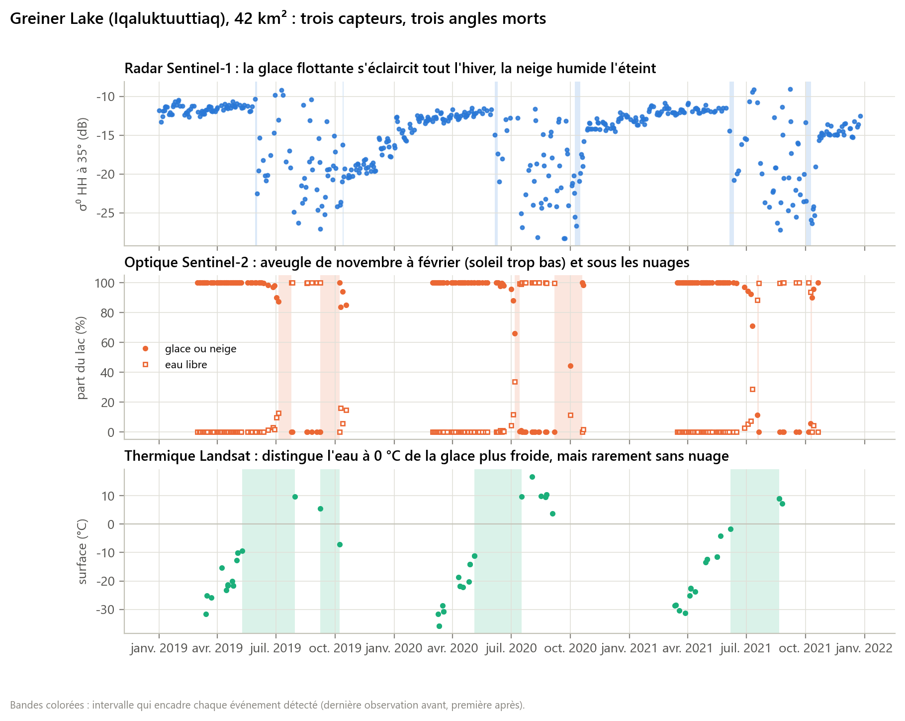
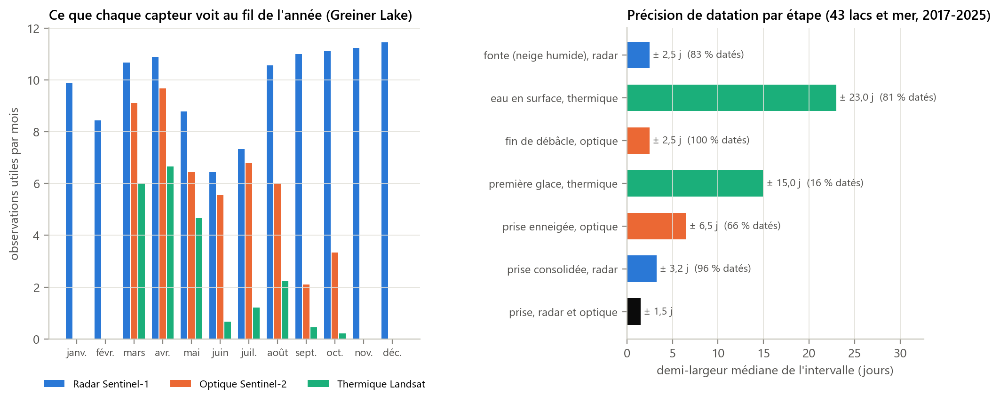
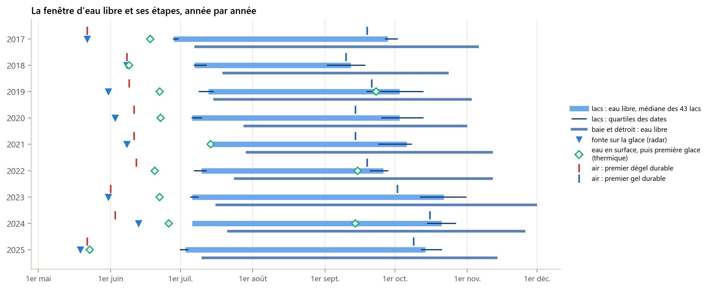
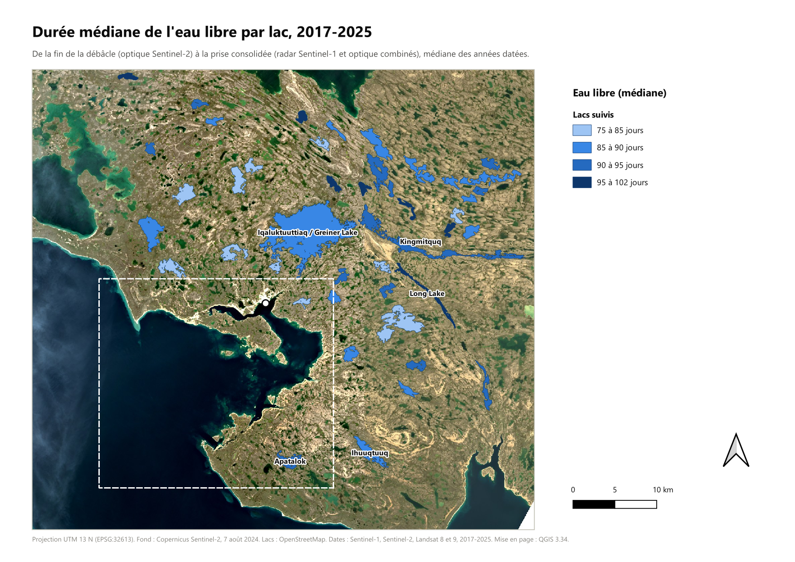
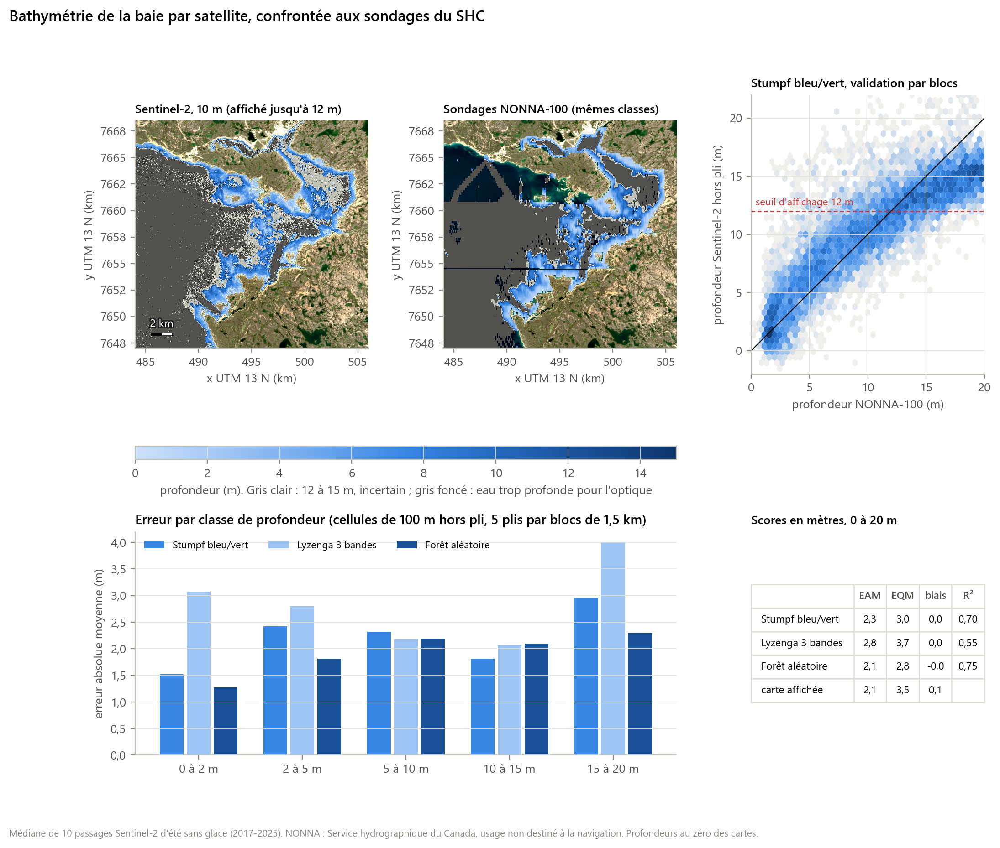
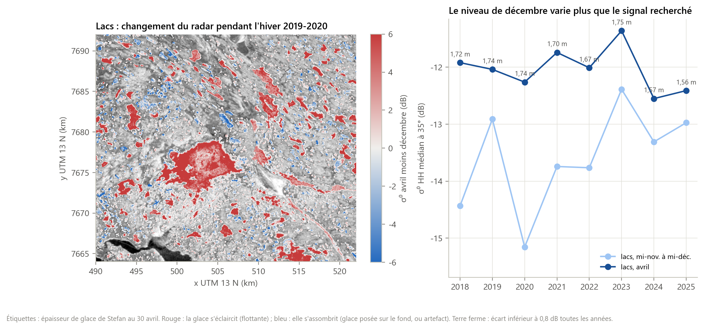

# Cambridge Bay, la fenêtre d'eau libre

**Gel, dégel et bathymétrie côtière autour d'Iqaluktuuttiaq (Nunavut), 2017-2025, à partir de données satellitaires ouvertes**

Chaîne reproductible qui date chaque année la débâcle et la prise des glaces de 43 lacs et de la baie de Cambridge Bay avec trois capteurs aux angles morts différents (radar Sentinel-1, optique Sentinel-2, thermique Landsat), mesure ce que chacun laisse dans l'ombre, puis restitue la bathymétrie de la baie pendant la fenêtre d'eau libre et la confronte aux sondages du Service hydrographique du Canada.

> Projet personnel de recherche, réalisé sans mesure de terrain et à partir de données ouvertes seulement. Les dates de glace sont validées par l'accord entre capteurs ; la bathymétrie n'est pas destinée à la navigation.

[English version](README.md), **[Article (PDF, 12 pages)](docs/article.pdf)**, [Sources et licences](docs/sources.md)

[](https://github.com/jauresmas/cambridge-bay-open-water/actions/workflows/controle.yml)

## En chiffres

| | |
|---|---:|
| Passages radar Sentinel-1 EW, optiques Sentinel-2 et scènes thermiques Landsat utiles (2017-2025) | 1 334, 1 079 et 531 |
| Lacs suivis (plus de 1 km²), plus la baie | 43 |
| Fonte sur la glace (radar), eau en surface (thermique), fin de la débâcle (optique), médianes | 31 mai, 22 juin, 7 juillet |
| Première glace (thermique), glace consolidée (radar et optique), médianes | 23 septembre, 5 octobre |
| Précision de la prise, radar seul puis combiné à l'optique | ± 3,2 j, puis ± 1,5 j |
| Eau libre des lacs, 2017-2022 puis 2023-2025 (médianes annuelles) | 83 j, puis 106 j |
| Eau libre de la baie (médiane) | 111 j, du 19 juillet au 12 novembre |
| Bathymétrie Sentinel-2, erreur absolue moyenne entre 0 et 20 m (validation par blocs, 8 812 cellules) | 2,3 m |
| Profondeur jusqu'à laquelle la carte est fiable | 12 m |
| Part de glace « posée » lue au radar contre épaisseur de Stefan (8 hivers) | r = -0,74, à l'inverse de l'hypothèse |

Tous ces chiffres sont lus dans `resultats/` par `scripts/09_article.py`, qui écrit l'[article](docs/article.md) : aucun n'est tapé à la main.

## Trois questions

1. **Dater la glace.** Peut-on dater la débâcle et la prise des glaces de chaque lac et de la baie, chaque année, et avec quelle précision, selon le capteur et en les combinant ?
2. **Voir le fond.** Pendant la fenêtre d'eau libre, jusqu'à quelle profondeur et avec quelle erreur Sentinel-2 restitue-t-il la bathymétrie côtière ?
3. **Glace flottante ou posée.** Le radar d'hiver sépare-t-il la glace flottante de la glace posée sur le fond, et cette part suit-elle l'épaisseur de glace de la loi de Stefan ?

## Trois capteurs, trois étapes, trois angles morts



Le radar voit toute l'année mais confond l'eau agitée et la glace humide ; l'optique voit l'eau libre mais pas pendant la nuit polaire ni sous les nuages ; le thermique sépare l'eau à 0 °C de la glace plus froide, mais rarement sans nuage. Surtout, ils ne voient pas la même chose : le thermique repère l'eau de fonte qui recouvre la glace, le radar la neige humide, l'optique la disparition de la glace. Chaque date est un intervalle entre deux observations, et deux capteurs ne sont combinés que s'ils voient la même étape (radar et optique pour la prise).



## La fenêtre d'eau libre



D'un lac à l'autre, l'eau libre dure de 76 à 101 jours. Les grands lacs s'ouvrent plus tard, mais gèlent aussi plus tard : la durée ne dépend pas de leur taille. Carte mise en page dans QGIS :



## La bathymétrie de la baie



Trois modèles (Stumpf, Lyzenga, forêt aléatoire) sont comparés en validation croisée **par blocs de 1,5 km**, pour que deux cellules voisines presque identiques ne servent pas l'une à apprendre et l'autre à tester. La carte n'affiche que les profondeurs où l'optique distingue encore le fond de l'eau profonde.

## Un test qui échoue, et pourquoi



La part de glace « posée sur le fond » lue au radar varie à l'inverse de l'épaisseur de glace de Stefan. La terre ferme, témoin, ne bouge pas : c'est le niveau des lacs en début d'hiver, très variable d'une année à l'autre, qui brouille le signal à 90 m de résolution. Le résultat est gardé et expliqué dans l'article plutôt qu'écarté.

## Méthode et outils

La méthode tient en cinq étapes :

1. **Lire** les images sans compte, fenêtre par fenêtre, sur une grille UTM 13 N commune (80 m pour les séries, 40 m pour les cartes radar, 10 m pour la bathymétrie).
2. **Convertir** chaque passage en grandeur physique : σ⁰ radar calibré et ramené à 35° d'incidence, classes optiques (nuage, eau libre, glace ou neige), température de surface Landsat.
3. **Dater** chaque étape par un intervalle entre deux observations réelles ; la demi-largeur de l'intervalle mesure ce que le capteur ne voit pas.
4. **Combiner** deux capteurs, par intersection de leurs intervalles, seulement s'ils voient la même étape (radar et optique pour la prise).
5. **Valider** : bathymétrie par validation croisée par blocs sur les sondages NONNA, glace posée contre la loi de Stefan, et deux étapes de la chaîne refaites dans QGIS.

| Outil | Version | Usage |
|---|---|---|
| Python | 3.10 | chaîne de traitement (scripts 00 à 11), tests |
| NumPy, pandas, SciPy | 1.26, 2.1, 1.15 | calcul, séries temporelles, statistiques |
| rasterio (GDAL) | 1.4 (GDAL 3.9) | lecture des COG, calibration radar, reprojection |
| GeoPandas, Shapely, pyproj | 1.1, 2.0, 3.7 | lacs, masques, projections |
| scikit-learn | 1.7 | forêt aléatoire, validation croisée |
| Matplotlib | 3.8 | figures de l'article |
| **QGIS** (PyQGIS, Processing) | **3.34 LTR** | projet cartographique, contrôleur temporel, mise en page, modeleur graphique |
| pytest | 8.3 | tests des méthodes |
| API STAC du Planetary Computer | | accès aux images Sentinel et Landsat |

### Le projet QGIS

Ouvrir [`qgis/cambridge_bay.qgz`](qgis/cambridge_bay.qgz) dans QGIS 3.34 ou plus récent. Les couches sont déjà stylées et rangées en quatre groupes : repères, glace des lacs, bathymétrie de la baie, fond Sentinel-2.

- **Animer l'eau libre** : cocher la couche « Eau libre par lac et par année (temporel) », ouvrir le contrôleur temporel (*Vue > Panneaux > Contrôleur temporel*), puis faire défiler les dates de 2017 à 2025.
- **Mise en page** : *Projet > Mises en page > Eau libre par lac* ; c'est la carte ci-dessus.
- **Modèles graphiques** : dans la boîte à outils, *Modèles > Ouvrir un modèle existant*, puis [`qgis/modeles/rapport_stumpf.model3`](qgis/modeles/rapport_stumpf.model3) (calculatrice raster GDAL) ou [`qgis/modeles/mediane_radar_lacs.model3`](qgis/modeles/mediane_radar_lacs.model3) (statistiques de zone). Appliqués aux mêmes données que la chaîne Python, ils donnent le même résultat : écart maximal de 9 × 10⁻⁷ sur 7 millions de pixels pour le rapport, écart nul sur les 43 médianes de lac ([`resultats/controle_qgis.csv`](resultats/controle_qgis.csv)).

Le projet est reconstruit par `scripts/11_projet_qgis.py`, lancé avec le Python de QGIS.

## Reproduire

Python 3.10 ou plus récent. Aucun compte n'est nécessaire : les images sont lues par le catalogue STAC du Planetary Computer, fenêtre par fenêtre (environ 3 Go en tout dans `data/`).

```bash
pip install -r requirements.txt
python scripts/run_all.py
```

| Étape | Script | Sortie principale |
|---|---|---|
| Zone, lacs, mer | `00_zone.py` | `data/zone/`, `resultats/lacs.csv` |
| Météo ECCC, degrés-jours, Stefan | `01_meteo.py` | `resultats/meteo_*.csv` |
| Série radar Sentinel-1 EW | `02_s1_series.py` | `resultats/s1_lacs.csv` |
| Série optique Sentinel-2 | `03_s2_series.py` | `resultats/s2_lacs.csv` |
| Série thermique Landsat 8 et 9 | `04_landsat_thermique.py` | `resultats/landsat_lacs.csv` |
| Bathymétrie et validation | `05_bathymetrie.py` | `resultats/bathymetrie_*` |
| Inventaire ICESat-2 ATL24 | `05b_icesat2_inventaire.py` | `resultats/icesat2_atl24_granules.csv` |
| Régime de glace de fin d'hiver | `06_glace_ancree.py` | `resultats/glace_regime_*` |
| Débâcle, prise, fusion, angles morts | `07_phenologie.py` | `resultats/phenologie_*.csv`, `fenetre_eau_libre.csv` |
| Figures | `08_figures.py` | `figures/` |
| Couches du projet QGIS | `10_couches_qgis.py` | `resultats/qgis/` |
| Projet QGIS, mise en page, modèles, contrôle croisé (Python de QGIS) | `11_projet_qgis.py` | `qgis/`, `figures/07_eau_libre_lacs.png`, `resultats/controle_qgis.csv` |
| Article | `09_article.py` | `docs/article.md`, `.html`, `.pdf` |

Les méthodes sont testées sur des cas construits, sans réseau : `python -m pytest`.

## Organisation

```
cbow/        bibliothèque : catalogue STAC, calibration radar, classes optiques,
             thermique, phénologie, bathymétrie, style des figures
scripts/     chaîne 00 à 11 (run_all.py les enchaîne)
qgis/        projet QGIS et modèles du modeleur graphique
resultats/   tableaux, rasters et couches dérivés (publiés)
figures/     figures de l'article
docs/        article (Markdown, HTML, PDF), sources et licences
tests/       tests des méthodes
```

## Suites

Mesures de terrain (plateforme MOACC, forages de glace, sondages de lacs), radar plus fin (RADARSAT Constellation, Sentinel-1C), infrarouge thermique aéroporté, hyperspectral pour séparer la couleur de l'eau de la profondeur, et calibration lidar ICESat-2 là où aucun sondage n'existe. Le détail est dans l'[article](docs/article.pdf).
