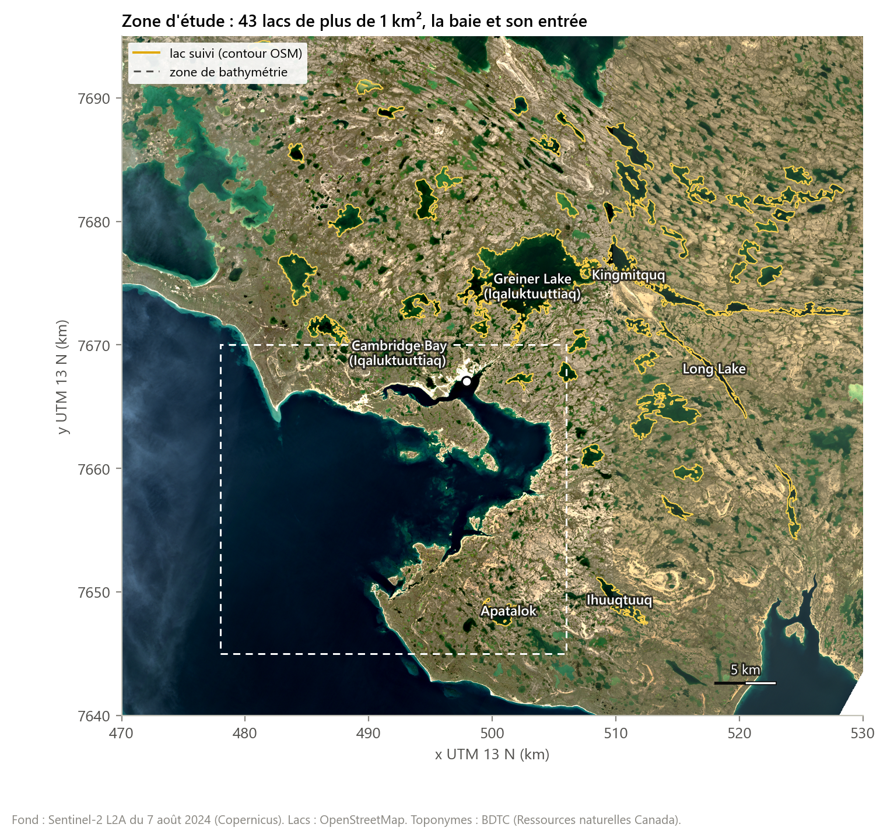

# Dater la glace par étapes : débâcle, prise des glaces et bathymétrie côtière autour de Cambridge Bay (Nunavut) avec trois capteurs satellitaires, 2017-2025

*Dating lake ice by stages: break-up, freeze-up and coastal bathymetry around Cambridge Bay (Nunavut) from three satellite sensors, 2017-2025*

**Jaurès DAA-HINGBANON**

Géomaticien, France. Travail de recherche personnel, sans financement. Code, données dérivées et figures : github.com/jauresmas/cambridge-bay-open-water. Version d'octobre 2026.

## Résumé

La débâcle et la prise des glaces des lacs arctiques sont souvent résumées par deux dates par an. Nous montrons qu'avec des capteurs différents, ces dates ne désignent pas le même événement. Autour de Cambridge Bay (Iqaluktuuttiaq, île Victoria, Nunavut), nous avons suivi 43 lacs de plus de 1 km² et la baie de 2017 à 2025 avec le radar Sentinel-1 (1 334 passages), l'optique Sentinel-2 (1 079 passages) et le thermique Landsat 8 et 9 (531 scènes utiles). Chaque transition est datée par l'intervalle qui sépare deux observations, ce qui chiffre ce que chaque capteur laisse dans l'ombre. Les trois capteurs datent des étapes successives : neige humide sur la glace au radar (médiane : 31 mai), eau de fonte en surface au thermique (22 juin), disparition de la glace en optique (7 juillet), puis première glace au thermique (23 septembre) et glace consolidée au radar et en optique (5 octobre). Combinés, radar et optique datent la prise à ± 1,5 jour. L'eau libre des lacs dure 89 jours en médiane ; la prise est plus tardive sur 2023-2025 et suit le premier gel durable de l'air (r = 0,83). Pendant l'été, Sentinel-2 restitue la bathymétrie de la baie avec une erreur absolue moyenne de 2,3 m entre 0 et 20 m (validation croisée par blocs sur les sondages NONNA du Service hydrographique du Canada), de façon fiable jusqu'à 12 m. En revanche, la séparation de la glace flottante et de la glace posée sur le fond par le radar en mode EW échoue : le signal varie à l'inverse de l'épaisseur de glace calculée par la loi de Stefan, brouillé par l'état des lacs en début d'hiver.

**Mots-clés :** glace de lac ; phénologie ; Sentinel-1 ; Sentinel-2 ; Landsat ; infrarouge thermique ; bathymétrie satellitaire ; Arctique canadien.

## Abstract

Lake ice break-up and freeze-up are often reduced to two dates per year. We show that different sensors date different events. Around Cambridge Bay (Iqaluktuuttiaq, Victoria Island, Nunavut), we monitored 43 lakes larger than 1 km² and the bay from 2017 to 2025 with Sentinel-1 radar (1,334 passes), Sentinel-2 optical imagery (1,079 passes) and Landsat 8 and 9 thermal imagery (531 useful scenes). Each transition is dated by the interval between two observations, which measures what each sensor misses. The sensors date successive stages: wet snow on the ice in radar (median 31 May), meltwater at the surface in thermal imagery (22 June), disappearance of the ice in optical imagery (7 July), then first ice in thermal imagery (23 September) and consolidated ice in radar and optical imagery (5 October). Combined, radar and optical imagery date freeze-up within ± 1.5 day. Lakes stay open for 89 days (median); freeze-up was later in 2023-2025 and follows the first sustained air frost (r = 0.83). In summer, Sentinel-2 retrieves the bathymetry of the bay with a mean absolute error of 2.3 m between 0 and 20 m (spatial block cross-validation against Canadian Hydrographic Service NONNA soundings), reliably down to 12 m. Separating floating from bedfast ice with EW-mode radar fails: the signal moves opposite to Stefan ice thickness, blurred by the state of the lakes in early winter.

**Keywords:** lake ice; phenology; Sentinel-1; Sentinel-2; Landsat; thermal infrared; satellite-derived bathymetry; Canadian Arctic.

## 1. Introduction

La durée du couvert de glace règle une grande part du fonctionnement des lacs arctiques : leur bilan de chaleur, leur mélange, la lumière disponible sous la glace. Sur la côte, elle fixe la saison de navigation et la période pendant laquelle l'imagerie optique voit le fond. Ce couvert répond aux conditions climatiques (Surdu et al., 2014), et le dégel du pergélisol modifie les lacs et les côtes de l'Arctique canadien. Le suivre chaque année sur des dizaines de lacs n'est possible que depuis l'espace.

Chaque famille de capteurs a ses contraintes. Le radar à synthèse d'ouverture voit à travers les nuages et pendant la nuit polaire ; il sert à suivre la glace de lac depuis une cinquantaine d'années (Murfitt et Duguay, 2021). Il distingue la glace flottante, rendue brillante par l'interface entre la glace et l'eau, de la glace posée sur le fond, plus sombre (Duguay et al., 2002 ; Engram et al., 2018), et il détecte la neige humide, qui absorbe le signal (Nagler et al., 2016). Il confond en revanche facilement l'eau agitée par le vent et la glace humide. L'optique voit nettement l'eau libre, mais ni sous les nuages ni pendant la nuit polaire. L'infrarouge thermique mesure la température de surface et sépare donc l'eau de la glace froide, au prix de scènes claires peu nombreuses.

Ces capteurs sont souvent comparés comme s'ils mesuraient la même chose. Notre hypothèse est qu'ils datent des étapes différentes d'un même processus, et qu'il faut les combiner étape par étape plutôt qu'en bloc. Pour le vérifier, nous datons chaque transition par un intervalle borné par deux observations réelles, ce qui donne aussi, pour chaque capteur, une mesure directe de sa précision.

La même fenêtre d'eau libre conditionne la bathymétrie dérivée de l'imagerie multispectrale. Les modèles de Lyzenga (1978) et de Stumpf et al. (2003) relient la profondeur à l'atténuation différente des bandes visibles dans l'eau. Ils demandent des sondages pour la calibration, rares dans l'Arctique, et une eau dégagée de glace pendant une saison courte.

Nous traitons trois questions sur la région de Cambridge Bay, où la plateforme MOACC suit en continu la neige, l'atmosphère et le pergélisol :

- (Q1) Peut-on dater la débâcle et la prise des glaces de chaque lac et de la baie, chaque année, et avec quelle précision selon le capteur et selon la façon de les combiner ?
- (Q2) Pendant la fenêtre d'eau libre, jusqu'à quelle profondeur et avec quelle erreur Sentinel-2 restitue-t-il la bathymétrie côtière, comparé aux sondages hydrographiques ?
- (Q3) Le radar d'hiver sépare-t-il la glace flottante de la glace posée sur le fond, et la part de glace posée suit-elle l'épaisseur de glace donnée par la loi de Stefan ?

## 2. Site d'étude

Le hameau de Cambridge Bay (Iqaluktuuttiaq) se trouve sur la côte sud-est de l'île Victoria, au bord d'une baie ouverte sur le détroit de Dease (69,1° N, 105,1° O). La zone d'étude couvre 60 km sur 55 km (figure 1). Le relief y reste inférieur à 200 m et les lacs y sont très nombreux. Nous suivons les 43 lacs de plus de 1 km² entièrement compris dans la zone et assez larges pour une grille de 80 m, dont Greiner Lake (Iqaluktuuttiaq, 42 km²). La Station canadienne de recherche dans l'Extrême-Arctique accueille la plateforme MOACC. Entre 2017 et 2025, l'air a cumulé de 4 246 à 5 323 degrés-jours de gel au 30 avril, ce qui correspond à une épaisseur de glace de Stefan de 1,56 à 1,75 m (section 3.6).

*Figure 1. Zone d'étude, sur une image Sentinel-2 du 7 août 2024. Contours jaunes : lacs suivis ; cadre pointillé : zone de bathymétrie.*

## 3. Méthode et outils

### 3.1 Données

Toutes les données sont ouvertes (tableau 1). Les images sont lues par le catalogue STAC du Planetary Computer de Microsoft, sans compte, en ne téléchargeant que la fenêtre utile de chaque fichier au format COG (Cloud Optimized GeoTIFF). Les traitements se font sur des grilles UTM 13 N de 80 m pour les séries, de 40 m pour les cartes radar et de 10 m pour la bathymétrie.

*Tableau 1. Données utilisées (2017-2025).*

| Source | Producteur | Usage | Volume |
|---|---|---|---|
| Sentinel-1 EW GRDM, HH | ESA, Copernicus | fonte, prise | 1 334 passages |
| Sentinel-2 L2A | ESA, Copernicus | débâcle, prise ; bathymétrie | 1 079 passages, mars à novembre |
| Landsat 8 et 9, collection 2, température de surface | USGS | eau en surface, première glace | 531 scènes utiles |
| Températures quotidiennes, 3 stations du hameau | ECCC | degrés-jours ; filtre de la fonte | 2016-2025 |
| NONNA-10 et NONNA-100 | Service hydrographique du Canada | calibration et validation | baie et entrée |
| Plans d'eau ; toponymes | OpenStreetMap ; BDTC (RNCan) | contours et noms des lacs | 43 lacs |

### 3.2 Radar Sentinel-1

Sur la zone, Sentinel-1 acquiert surtout en mode EW (Extra Wide), en polarisation HH. Pour chaque passage, le compte numérique DN est converti en coefficient de rétrodiffusion :

> σ⁰ = (DN² - N) / A²  (1)

où A est la table de calibration sigmaNought et N le bruit thermique en distance et en azimut, interpolés aux pixels lus.

L'image est ensuite projetée par les points d'appui du produit, ce qui suffit sur un terrain aussi plat. L'angle d'incidence θ varie de 19 à 47° selon l'orbite et pèse plusieurs décibels. Pour chaque lac, nous estimons la pente β sur les mois de janvier à avril, quand la glace évolue lentement, par une régression du σ⁰ sur θ avec un niveau propre à chaque hiver, puis nous ramenons tous les passages à 35° :

> σ⁰₃₅ = σ⁰(θ) - β (θ - 35°)  (2)

La pente médiane des lacs vaut -0,225 dB par degré.

La fonte est datée par la première baisse de 3 dB sous le niveau médian de février à avril, à condition qu'elle soit confirmée par l'un des deux passages suivants. Les passages du matin, sur une neige regelée, et ceux de midi, sur une neige humide, alternent : exiger un état durable retarderait la date de plusieurs semaines. Une baisse n'est retenue que si la température moyenne de l'air a dépassé -5 °C dans les trois jours. La prise est datée par la fin de la variabilité propre à l'eau libre : l'écart médian entre quatre passages successifs passe sous 1,2 dB.

### 3.3 Optique Sentinel-2

Chaque passage est lu à 80 m dans les bandes verte (B03) et infrarouge moyen (B11), avec la carte de classes de scène (SCL) produite par Sen2Cor. On calcule :

> NDSI = (ρB03 - ρB11) / (ρB03 + ρB11)  (3)

où ρ est la réflectance de surface.

Un pixel est un nuage si la SCL l'indique (ombre, nuage moyen ou haut, cirrus) ou si ρ(B11) dépasse 0,20 ; de l'eau libre si ρ(B03) est inférieure à 0,08, ou si la SCL le classe en eau avec ρ(B03) inférieure à 0,20 ; de la glace ou de la neige si le NDSI dépasse 0,42 et ρ(B03) dépasse 0,10. La part de chaque classe est calculée sur l'intérieur des lacs, à 120 m des rives, et un passage n'est retenu que si 60 % du lac au moins est vu sans nuage.

### 3.4 Thermique Landsat

La température de surface de la collection 2 (bande 10) est retenue hors nuage et ombre selon le masque QA_PIXEL, à plus de 1 km du nuage le plus proche et avec une incertitude d'au plus 3 K. Une surface entièrement au-dessus de 2 °C contient de l'eau liquide ; une surface entièrement sous -1 °C est gelée.

### 3.5 Datation par intervalles et fusion

Chaque étape est définie par un état ancien et un état nouveau (tableau 2). Pour un lac et une année, t⁻ est la dernière observation de l'état ancien et t⁺ la première observation de l'état nouveau après laquelle l'état ancien ne revient presque plus (au plus une fois, ou dans 15 % des observations suivantes). La date et sa précision sont :

> t = (t⁻ + t⁺) / 2 ;  δ = (t⁺ - t⁻) / 2  (4)

La demi-largeur δ mesure ce que le capteur laisse dans l'ombre (nuages, nuit polaire, revisite).

Deux capteurs ne sont combinés que s'ils voient la même étape, ce qui est le cas du radar et de l'optique pour la prise. La date combinée est alors le milieu de l'intersection des deux intervalles. Si les intervalles ne se recoupent pas, le cas est compté comme discordant et l'intervalle le plus étroit est conservé.

*Tableau 2. Critères de chaque étape. Les seuils sont communs à tous les lacs.*

| Étape | Capteur | État ancien | État nouveau |
|---|---|---|---|
| Fonte | Radar | passage qui précède la détection | σ⁰ à 3 dB ou plus sous l'hiver, confirmé, air au-dessus de -5 °C |
| Eau en surface | Thermique | médiane sous 0,5 °C | toute la surface au-dessus de 2 °C |
| Fin de la débâcle | Optique | glace sur 10 % du lac ou plus | eau libre sur 90 % du lac |
| Première glace | Thermique | médiane au-dessus de 0,5 °C | toute la surface sous -1 °C |
| Prise sous la neige | Optique | eau libre sur 50 % du lac ou plus | glace ou neige sur 90 % |
| Prise consolidée | Radar | écart entre passages au-dessus de 1,8 dB | écart sous 1,2 dB |

### 3.6 Régime de la glace en fin d'hiver

Sous la glace flottante, le σ⁰ croît pendant l'hiver ; quand la glace touche le fond, le contraste de l'interface disparaît et le σ⁰ baisse. Nous comparons donc, pixel par pixel à 40 m, la médiane d'avril à celle de mi-novembre à mi-décembre. Une hausse d'au moins 1,5 dB signale une glace flottante, une baisse d'au moins 1,5 dB une glace probablement posée ; entre les deux, le pixel reste indéterminé. La terre ferme sert de témoin. L'épaisseur de glace attendue au 30 avril vient de la loi de Stefan (Leppäranta, 1993) :

> h = α √DJG  (5)

où DJG est la somme des degrés-jours de gel depuis le 1er septembre et α un coefficient empirique, pris égal à 0,024 m par (degré-jour)1/2, avec 0,017 et 0,027 en bornes.

Si la méthode fonctionne, la part de glace posée doit croître avec h, puisque la glace atteint alors le fond sur une plus grande surface.

### 3.7 Bathymétrie

Dix passages d'été sans glace ni nuage sont choisis automatiquement parmi ceux de 2017 à 2025, en retenant ceux dont le proche infrarouge reste le plus proche de zéro sur l'eau profonde. Le reflet du soleil est retiré par régression des bandes visibles sur le proche infrarouge (Hedley et al., 2005), puis les variables sont combinées par médiane. Nous comparons trois modèles : le rapport de Stumpf et al. (2003),

> z = m1 ln(n ρbleu) / ln(n ρvert) - m0  (6)

avec n = 1000 ; le modèle log-linéaire de Lyzenga (1978),

> z = a0 + Σ ai ln(ρi - ρi,∞)  (7)

où ρi,∞ est la réflectance de l'eau profonde dans les bandes bleue, verte et rouge ; et une forêt aléatoire sur les mêmes variables, comme borne empirique.

La calibration et la validation utilisent les 8 812 cellules de 100 m de NONNA-100 entre 0 et 20 m, où les variables Sentinel-2 sont moyennées. Les cellules sont regroupées par blocs de 1,5 km répartis en cinq plis : deux cellules voisines, presque identiques, ne peuvent pas servir l'une à apprendre et l'autre à tester. La profondeur limite optique est celle au-delà de laquelle le rapport de Stumpf cesse de croître, estimée par un modèle à charnière. Enfin, nous cherchons la profondeur prédite au-delà de laquelle plus de 10 % des cellules sont en réalité plus profondes que 20 m : la carte n'affiche que les valeurs en deçà.

### 3.8 Outils

La chaîne de traitement est écrite en Python (tableau 3). Elle lit les images par fenêtres, calibre le radar, classe les pixels, date les étapes et ajuste les modèles de bathymétrie ; Matplotlib produit les figures 1 à 4, 6 et 7. QGIS sert à trois choses. Il rassemble toutes les couches du travail dans un projet stylé, consultable sans programmer. Son contrôleur temporel anime l'eau libre de chaque lac, année par année, à partir d'une couche qui porte les dates de débâcle et de prise. Sa mise en page produit la carte de la figure 5.

QGIS sert enfin de contrôle indépendant du code. Deux étapes de la chaîne ont été refaites dans son modeleur graphique : le rapport de Stumpf, avec la calculatrice raster de GDAL, et la médiane du radar par lac, avec l'outil de statistiques de zone. Appliqués aux mêmes données que la chaîne Python, les deux modèles donnent un écart maximal de 9 × 10-7 sur 6 999 439 pixels pour le rapport, soit la précision du calcul en simple précision, et un écart nul sur les 43 médianes de lac.

*Tableau 3. Outils utilisés et versions.*

| Outil | Version | Usage dans ce travail |
|---|---|---|
| Python | 3.10.11 | chaîne de traitement (scripts 00 à 11), tests |
| NumPy, pandas, SciPy | 1.26.4, 2.1.4, 1.15.3 | calcul matriciel, séries temporelles, statistiques |
| rasterio (GDAL) | 1.4.2 (GDAL 3.9.3) | lecture des COG, calibration radar, reprojection, rastérisation |
| GeoPandas, Shapely, pyproj | 1.1.2, 2.0.2, 3.7.0 | lacs, masques, projections |
| scikit-learn | 1.7.2 | forêt aléatoire, validation croisée |
| Matplotlib | 3.8.2 | figures 1 à 4, 6 et 7 |
| QGIS (PyQGIS, Processing) | 3.34.12 LTR (Prizren) | projet cartographique, contrôleur temporel, mise en page de la figure 5, modeleur graphique (deux modèles et contrôle croisé) |
| pytest | 8.3.3 | seize tests des méthodes sur des cas construits |
| API STAC du Planetary Computer |  | recherche et accès aux images sans compte |

La chaîne complète (environ 3 Go de téléchargements), le projet QGIS, ses deux modèles et les tests sont publiés (github.com/jauresmas/cambridge-bay-open-water). Les chiffres de cet article sont lus directement dans les tableaux de résultats produits par la chaîne.

## 4. Résultats

### 4.1 Ce que chaque capteur observe

Sur Greiner Lake, le radar fournit 142 à 170 observations par an jusqu'en 2021, puis 40 à 45 de 2022 à 2024, après la perte de Sentinel-1B, et 144 en 2025 avec Sentinel-1C. L'optique en fournit 33 à 60 par an, toutes entre mars et octobre, et le thermique 12 à 41, davantage depuis l'arrivée de Landsat 9 (figure 3). Le radar est le seul à voir les lacs de novembre à février, quand le soleil est trop bas pour l'optique et le thermique. Ces deux capteurs observent surtout au printemps, quand les nuages sont rares, et beaucoup moins en été et en automne (figure 2).

*Figure 2. Greiner Lake vu par les trois capteurs, 2019-2021 : σ⁰ ramené à 35° (radar), parts de glace et d'eau libre (optique), température de surface (thermique). Les bandes colorées encadrent chaque étape détectée.*

### 4.2 Les étapes de la débâcle et de la prise

Le tableau 4 résume les 387 couples lac-année. Les étapes se succèdent dans le même ordre presque partout : la neige humide apparaît sur la glace vers le 31 mai, l'eau en surface vers le 22 juin, et la glace disparaît vers le 7 juillet. À l'automne, la première glace se forme vers le 23 septembre et la glace consolidée s'installe vers le 5 octobre.

*Tableau 4. Dates des étapes sur les 43 lacs, 2017-2025 (387 couples lac-année).*

| Étape | Capteur | Date médiane | 1er à 3e quartile | Précision médiane | Cas datés |
|---|---|---|---|---|---|
| Fonte : neige humide sur la glace | Radar Sentinel-1 | 31 mai | 22 mai au 8 juin | ± 2,5 j | 84 % |
| Eau en surface | Thermique Landsat | 22 juin | 10 juin au 26 juin | ± 23,0 j | 81 % |
| Fin de la débâcle | Optique Sentinel-2 | 7 juillet | 3 juillet au 12 juillet | ± 2,5 j | 100 % |
| Première glace | Thermique Landsat | 23 septembre | 14 septembre au 23 septembre | ± 15,0 j | 17 % |
| Prise sous la neige | Optique Sentinel-2 | 30 septembre | 22 septembre au 6 octobre | ± 6,5 j | 68 % |
| Prise consolidée | Radar Sentinel-1 | 4 octobre | 22 septembre au 15 octobre | ± 3,5 j | 96 % |
| Prise consolidée | Radar et optique combinés | 5 octobre | 22 septembre au 14 octobre | ± 1,5 j |  |

La précision dépend du capteur bien plus que de l'étape. Le radar et l'optique datent leurs étapes à quelques jours près (± 2,5 jours pour la fonte, ± 2,5 jours pour la fin de la débâcle) ; le thermique, faute de scènes claires, ne date l'eau en surface qu'à ± 23 jours et la première glace que dans 17 % des cas. L'optique ne date la prise que dans 68 % des cas : les nuages d'automne et le soleil bas laissent peu d'images en octobre, souvent avant que la glace ne soit enneigée.

*Figure 3. À gauche, observations utiles par mois et par an sur Greiner Lake. À droite, demi-largeur médiane des intervalles par étape, et part des cas datés.*

Notre premier essai combinait l'optique et le thermique pour la fin de la débâcle. Leurs dates s'écartaient de deux semaines, et les désaccords avaient une cause physique nette. Le 27 mai 2025, par exemple, toute la surface de Greiner Lake dépasse 2 °C en thermique, alors que l'optique la montre couverte de glace jusqu'au 2 juillet : le thermique voit l'eau de fonte qui recouvre la glace, pas la disparition de la glace. En médiane, l'eau en surface précède la fin de la débâcle de 14 jours (quartiles : 9 et 22), et la fonte radar la précède de 37 jours. À l'automne, la glace consolidée vient 13 jours après la première glace thermique.

Pour la prise, le radar et l'optique voient bien la même étape : leurs dates s'écartent de 9 jours en valeur absolue médiane, avec un biais de -2 jours. Leur intersection ramène la précision à ± 1,5 jour. Les intervalles restent toutefois disjoints dans 112 cas sur 375. Le seuil radar de 1,2 dB, fixé avant toute comparaison, donne face à l'optique un biais de 0 jour sur 2017-2020 et de 2 jours sur 2021-2025 ; les seuils de 0,8 à 2,0 dB testés autour de lui donnent des écarts absolus médians de 6 à 16 jours. Le critère reste donc stable malgré la baisse de revisite après 2021.

### 4.3 Variabilité d'une année à l'autre

Sur les lacs, l'eau libre dure 89 jours en médiane (quartiles 78 et 102 jours). La fin de la débâcle varie peu d'une année à l'autre (16 jours entre les années extrêmes) et suit le premier dégel durable de l'air de 33 jours en médiane (r = 0,82 sur 9 ans). La prise varie davantage (40 jours) et suit le premier gel durable de l'air de 9 jours (r = 0,83). Sur 2023-2025, elle survient le 21 octobre en médiane, contre le 1er octobre sur 2017-2022, et l'eau libre passe de 83 à 106 jours. Le premier gel durable de l'air a lui aussi reculé, du 17 septembre au 9 octobre en médiane (tableau 5, figure 4). Greiner Lake, le plus grand, s'ouvre le 12 juillet et gèle le 12 octobre en médiane. Dans la baie, l'eau libre dure 111 jours, du 19 juillet au 12 novembre.

*Tableau 5. Bilan annuel. DJG : degrés-jours de gel cumulés depuis le 1er septembre. Dégel et gel de l'air : premier jour de cinq jours consécutifs à moyenne positive (ou négative). Dates des lacs : médianes des lacs. nd : non daté.*

| Année | DJG au 30 avril | h Stefan (m) | Dégel de l'air | Fin de débâcle (lacs) | Gel de l'air | Prise (lacs) | Eau libre, lacs (j) | Eau libre, baie (j) |
|---|---|---|---|---|---|---|---|---|
| 2017 | 4 946 | 1,69 | 22 mai | 28 juin | 19 septembre | 28 septembre | 92 | 122 |
| 2018 | 5 157 | 1,72 | 8 juin | 7 juillet | 10 septembre | 12 septembre | 67 | 96 |
| 2019 | 5 277 | 1,74 | 9 juin | 13 juillet | 21 septembre | 3 octobre | 82 | 111 |
| 2020 | 5 230 | 1,74 | 11 juin | 6 juillet | 14 septembre | 3 octobre | 87 | 96 |
| 2021 | 5 030 | 1,70 | 11 juin | 14 juillet | 14 septembre | 6 octobre | 84 | 106 |
| 2022 | 4 821 | 1,67 | 12 juin | 10 juillet | 19 septembre | 26 septembre | 79 | 111 |
| 2023 | 5 323 | 1,75 | 1er juin | 6 juillet | 2 octobre | 22 octobre | 106 | 138 |
| 2024 | 4 300 | 1,57 | 3 juin | 6 juillet | 16 octobre | 21 octobre | 107 | 128 |
| 2025 | 4 246 | 1,56 | 22 mai | 3 juillet | 9 octobre | 14 octobre | 104 | 127 |

*Figure 4. Étapes de la débâcle et de la prise des lacs (médiane et quartiles des lacs), eau libre de la baie, premiers dégel et gel durables de l'air.*

D'un lac à l'autre, la durée médiane de l'eau libre va de 76 à 101 jours (figure 5). Les grands lacs s'ouvrent plus tard (corrélation de Spearman entre surface et date de fin de débâcle : ρ = 0,49, p < 0,001), mais la durée de l'eau libre ne dépend pas de leur taille (ρ = -0,12, p = 0,45) : un lac qui s'ouvre tard gèle aussi plus tard.

*Figure 5. Durée médiane de l'eau libre par lac, 2017-2025. Carte mise en page dans QGIS à partir du projet publié avec le code.*

### 4.4 Glace flottante ou posée : un test qui échoue

La carte du changement de σ⁰ entre décembre et avril montre des centres de lacs qui s'éclaircissent et des marges qui s'assombrissent, ce qu'on attend d'une glace flottante au centre et posée sur les hauts-fonds (figure 6). Mais d'une année à l'autre, la part de glace « posée » ainsi définie, de 14 à 28 % des pixels de lac, diminue quand l'épaisseur de Stefan augmente (r = -0,74 sur 8 hivers), à l'inverse de l'hypothèse. Le témoin terrestre reste stable : son écart entre décembre et avril ne dépasse pas 0,8 dB. En revanche, le niveau médian des lacs en décembre varie de 2,8 dB entre les hivers.

*Figure 6. À gauche, changement du σ⁰ entre décembre 2019 et avril 2020 sur les lacs (rouge : hausse, bleu : baisse). À droite, niveau médian des lacs en début et en fin d'hiver ; étiquettes : épaisseur de Stefan au 30 avril.*

### 4.5 Bathymétrie de la baie

Le rapport de Stumpf donne une erreur absolue moyenne de 2,32 m en validation croisée par blocs (tableau 6), meilleure que celle du modèle de Lyzenga et proche de celle de la forêt aléatoire. L'erreur est la plus faible entre 0 et 2 m (1,5 m). Les faibles profondeurs sont surestimées (biais de 1,0 m entre 0 et 2 m) et les fortes sous-estimées (-2,7 m entre 15 et 20 m). Le rapport cesse de croître vers 18 m. Dès 12 m prédits, plus de 10 % des cellules sont en réalité plus profondes que 20 m ; au-delà de 15 m prédits, c'est la majorité. La carte n'affiche donc que les profondeurs prédites jusqu'à 12 m : sur ces cellules, l'erreur absolue moyenne est de 2,1 m, le biais de 0,1 m, et 1,1 % des cellules affichées sont en fait plus profondes que 20 m (figure 7). À 10 m de résolution, sur les pixels NONNA-10 de 0 à 18 m, l'erreur absolue moyenne atteint 2,2 m avec un biais de -1,7 m.

*Tableau 6. Scores de la bathymétrie entre 0 et 20 m, cellules de 100 m hors pli (8 812 cellules). EAM : erreur absolue moyenne ; EQM : erreur quadratique moyenne.*

| Modèle | EAM (m) | EQM (m) | Biais (m) | R² |
|---|---|---|---|---|
| Stumpf bleu/vert | 2,32 | 3,03 | 0,00 | 0,70 |
| Lyzenga 3 bandes | 2,78 | 3,72 | 0,01 | 0,55 |
| Forêt aléatoire | 2,07 | 2,79 | -0,00 | 0,75 |
| Carte affichée (prédiction jusqu'à 12 m) | 2,11 | 3,55 | 0,09 |  |

*Figure 7. Bathymétrie Sentinel-2 à 10 m et sondages NONNA-100, nuage de validation croisée et erreur par classe de profondeur.*

## 5. Discussion

### 5.1 Une débâcle, plusieurs dates

Le résultat principal est qu'une « date de débâcle » dépend du capteur qui la mesure. Entre la neige humide vue au radar et la disparition de la glace vue en optique, 37 jours s'écoulent en médiane ; entre l'eau en surface vue en thermique et cette même disparition, 14 jours. Comparer des dates obtenues avec des capteurs différents, ou les fusionner sans précaution, revient donc à mélanger des étapes séparées de deux à cinq semaines. La datation par intervalles rend ce problème visible, parce que chaque date porte sa propre incertitude et que deux intervalles incompatibles le restent. Elle montre aussi ce qu'apporte une combinaison bien choisie : la prise passe de ± 3,5 jours (radar) à ± 1,5 jour quand l'optique la confirme.

L'interprétation du signal thermique de juin comme de l'eau de fonte sur la glace reste une hypothèse. Elle est cohérente avec l'optique, qui voit encore de la glace, mais aucune mesure de terrain ne la confirme ici. Une partie de l'écart pourrait aussi venir des pixels de rive, plus chauds, malgré l'érosion de 120 m.

### 5.2 Pourquoi le test de la glace posée échoue

Trois raisons se cumulent. L'épaisseur de Stefan ne varie que de 1,56 à 1,75 m sur la période : l'effet attendu sur la surface de glace posée est faible. Le niveau des lacs en décembre, qui dépend de la date de prise et de l'épaisseur déjà atteinte, varie de 2,8 dB, plus que le signal recherché. Enfin, à environ 90 m de résolution, les marges peu profondes des petits lacs se mêlent à la rive et à la glace flottante. Une détection fondée sur le moment où chaque pixel s'assombrit, plutôt que sur deux composites, et un radar plus fin conviendraient mieux, avec des mesures d'épaisseur de glace pour trancher.

### 5.3 Bathymétrie dans une eau arctique

La forêt aléatoire ne fait guère mieux que le rapport de Stumpf (2,07 contre 2,32 m) : la limite vient du signal, pas du modèle. Au-delà d'une douzaine de mètres, la lumière qui revient du fond ne se distingue plus de celle de la colonne d'eau, et la régression tasse les valeurs vers la moyenne, d'où la surestimation des faibles profondeurs et la sous-estimation des fortes. Les cellules de NONNA-100 mêlent par ailleurs des levés d'époques différentes, et leurs profondeurs sont rapportées au zéro des cartes, pas au niveau de l'eau le jour de l'image.

### 5.4 Limites

- Aucune mesure de terrain n'a été faite : les étapes de la glace ne sont validées que par l'accord entre capteurs, et la glace posée n'est pas vérifiée.
- Les seuils sont communs à tous les lacs et les contours d'OpenStreetMap ne suivent pas les variations de niveau. La règle de l'eau libre en optique a été révisée en cours de travail : de l'eau turbide de fin d'été, que Sen2Cor classe en eau mais dont la réflectance verte approche 0,11, passait pour de la glace (Greiner Lake, août 2024).
- Le masque de nuages de Sen2Cor prend souvent la glace fondante pour un nuage : des observations sont perdues pendant la débâcle, ce qui élargit les intervalles.
- Les sondages NONNA servent à la fois à calibrer et à valider. Les blocs spatiaux limitent le biais d'autocorrélation, sans remplacer un levé indépendant.
- Neuf années ne suffisent pas pour établir une tendance climatique.

### 5.5 Perspectives

Les mesures continues de la plateforme MOACC, des forages de glace et des sondages de lacs permettraient de valider les étapes et le régime de la glace. Les sondages de lacs peuvent être transformés en bathymétrie et en courbes hypsométriques avec l'extension QGIS LimnoTools, que nous avons développée. La RADARSAT Constellation Mission et Sentinel-1C offrent une meilleure résolution ou une meilleure revisite pour la glace posée. L'infrarouge thermique aéroporté rendrait la première glace et l'eau de fonte visibles sur les petits lacs. L'imagerie hyperspectrale aiderait à séparer la couleur de l'eau, liée à la matière organique dissoute et à la turbidité, de l'effet de la profondeur, pour dépasser la limite de 12 m. Enfin, 131 passages du lidar ICESat-2 (produit ATL24) recoupent la baie, dont 24 en août ou septembre : ils permettraient de calibrer Sentinel-2 sans sondage, puis de vérifier le résultat sur NONNA, une démarche transposable aux côtes arctiques qui n'ont jamais été sondées.

## 6. Conclusion

Le radar, l'optique et le thermique ne datent pas la même chose. Autour de Cambridge Bay, ils voient des étapes successives de la débâcle et de la prise, séparées de deux à cinq semaines, et ne doivent être combinés que lorsqu'ils voient la même étape. Ainsi combinés, le radar et l'optique datent la prise des lacs à ± 1,5 jour. La fenêtre d'eau libre des lacs dure 89 jours en médiane et suit la température de l'air, en particulier à l'automne.

Pendant cette fenêtre, Sentinel-2 restitue la bathymétrie de la baie jusqu'à environ 12 m avec une erreur absolue moyenne de l'ordre de 2 m. La séparation de la glace flottante et de la glace posée échoue à la résolution du radar EW ; ce résultat négatif indique ce qu'il faudrait mesurer sur le terrain pour aller plus loin.

## Code et données

Code, résultats dérivés et figures : github.com/jauresmas/cambridge-bay-open-water. Données : Copernicus Sentinel (2017-2025, données modifiées) ; U.S. Geological Survey (Landsat, collection 2) ; Environnement et Changement climatique Canada ; Service hydrographique du Canada (NONNA, usage non destiné à la navigation) ; Ressources naturelles Canada (Base de données toponymiques du Canada), sous Licence du gouvernement ouvert du Canada ; contributeurs OpenStreetMap (ODbL).

## Références

- Duguay, C. R., Pultz, T. J., Lafleur, P. M. et Drai, D. (2002). RADARSAT backscatter characteristics of ice growing on shallow sub-Arctic lakes, Churchill, Manitoba, Canada. Hydrological Processes, 16(8), 1631-1644.
- Engram, M., Arp, C. D., Jones, B. M., Ajadi, O. A. et Meyer, F. J. (2018). Analyzing floating and bedfast lake ice regimes across Arctic Alaska using 25 years of space-borne SAR imagery. Remote Sensing of Environment, 209, 660-676.
- Hedley, J. D., Harborne, A. R. et Mumby, P. J. (2005). Simple and robust removal of sun glint for mapping shallow-water benthos. International Journal of Remote Sensing, 26(10), 2107-2112.
- Leppäranta, M. (1993). A review of analytical models of sea-ice growth. Atmosphere-Ocean, 31(1), 123-138.
- Lyzenga, D. R. (1978). Passive remote sensing techniques for mapping water depth and bottom features. Applied Optics, 17(3), 379-383.
- Murfitt, J. et Duguay, C. R. (2021). 50 years of lake ice research from active microwave remote sensing: progress and prospects. Remote Sensing of Environment, 264, 112616.
- Nagler, T., Rott, H., Ripper, E., Bippus, G. et Hetzenecker, M. (2016). Advancements for snowmelt monitoring by means of Sentinel-1 SAR. Remote Sensing, 8(4), 348.
- Stumpf, R. P., Holderied, K. et Sinclair, M. (2003). Determination of water depth with high-resolution satellite imagery over variable bottom types. Limnology and Oceanography, 48(1, partie 2), 547-556.
- Surdu, C. M., Duguay, C. R., Brown, L. C. et Fernández Prieto, D. (2014). Response of ice cover on shallow lakes of the North Slope of Alaska to contemporary climate conditions (1950-2011): radar remote-sensing and numerical modeling data analysis. The Cryosphere, 8, 167-180.
